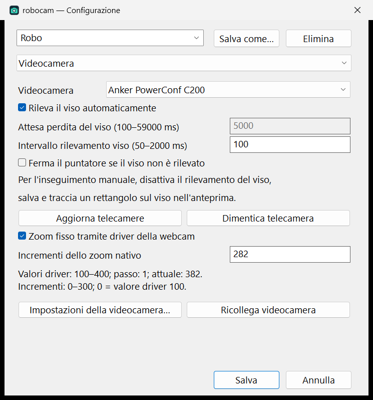
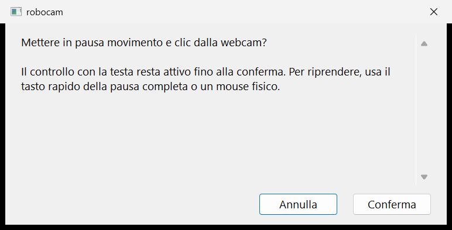
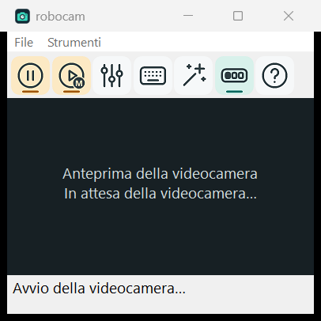
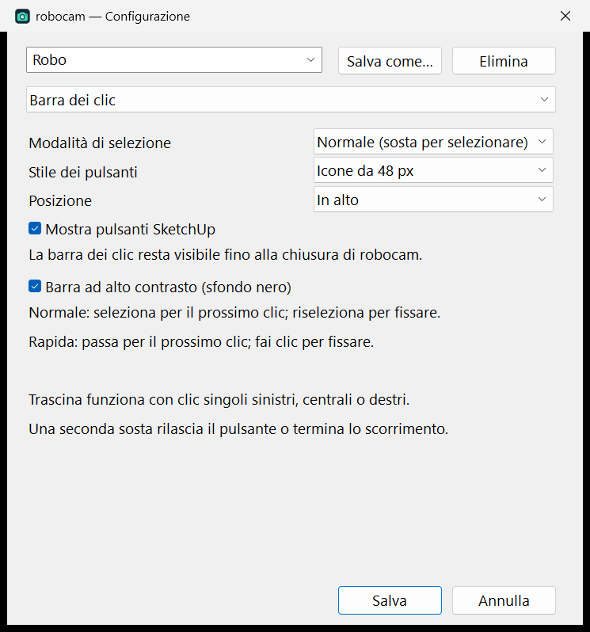
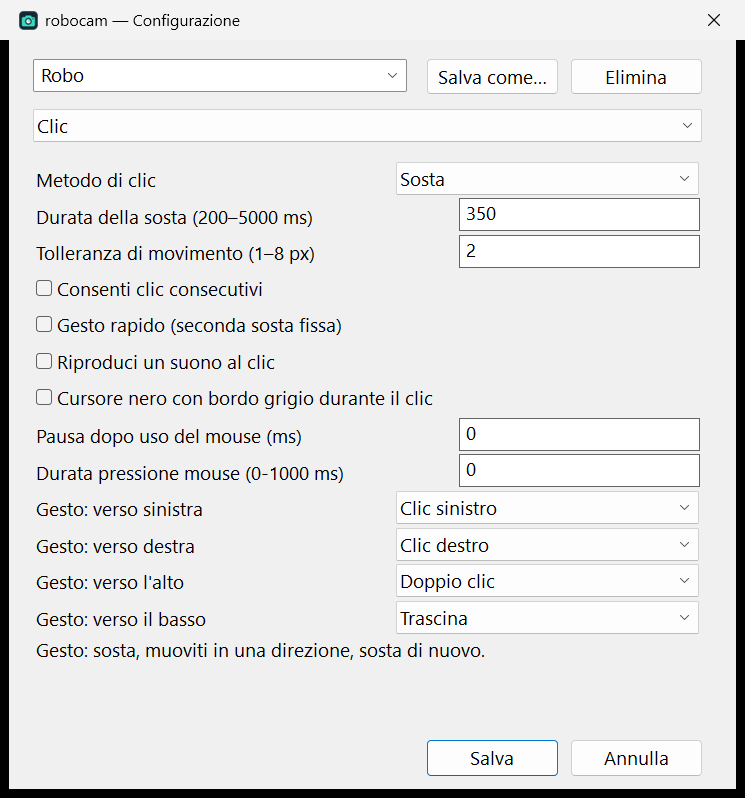
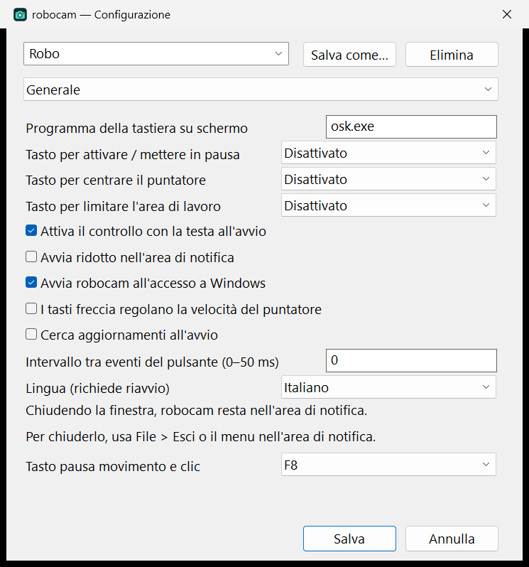
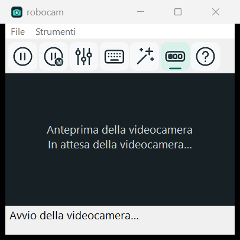

# robocam

A Windows 11 head-controlled mouse written in Rust, with a native interface and
OpenCV face detection and optical-flow tracking. Camera images stay on the PC.

## Install and start

Download the installer from [GitHub Releases](https://github.com/alexpacio/robocam/releases/latest).
It installs under `Program Files\robocam` and
requests administrator permission so input can reach elevated desktop applications,
including Task Manager and the Windows on-screen keyboard. Login startup is checked
by default and uses a highest-privilege interactive task for the current user.

Normal launches request elevation. robocam sets its own process priority to
**Realtime** and rechecks it each second. OpenCV parallelism is limited to one thread.
Realtime is an aggressive scheduling class; it cannot prevent hardware/driver stalls
and can reduce CPU time available to other applications.

## Camera

Open **Configuration > Camera** to choose a device by name, then **Save**. The
selection is saved per profile using device identity, so changing device order does
not select the wrong camera. A missing saved camera is reported explicitly.

With no saved camera, a single detected camera opens automatically; multiple cameras
prompt for a choice. **Refresh cameras** updates the list. **Forget saved camera**
selects automatic mode; press **Save** to apply the reset.

### Fixed native webcam zoom

Enable **Configuration > Camera > Fixed zoom via camera driver** and set
**Native zoom increments**. Robocam reads the selected device's minimum, maximum
and step using Windows `IAMCameraControl`, and requests `minimum + increments × step`.
It reads zoom at every camera start/reconnect and sends a manual driver command
only if the value differs, then reads it back to verify the result.

The **Anker PowerConf C200** exposes 100–400 in steps of 1. The **Robo** profile uses
**282 increments**, giving native value **382**. These are driver units, not a
claim of optical magnification. Zoom is performed by the camera/driver; robocam
does not crop or enlarge frames to imitate zoom. An unsupported driver or an
out-of-range setting produces an explicit error. Disable fixed zoom to leave the
driver's setting alone.



## Pointer and click toolbar

Move your head to move the pointer and stop over a target to click. **Pause stops
screen clicks only**: video and head-driven pointer movement continue. Dwell on
**Play** to resume. In the **main window**, the second button, immediately right of
Play/Pause, stops both movement and clicks after a confirmation dialog. Head control
remains usable until you confirm; Cancel leaves it unchanged. Camera preview continues,
held buttons are released and pending clicks are cancelled. Resume with a physical
click on the same button and confirm, or use **F8** (configurable in General settings).
The hotkey toggles full pause immediately. A stationary pointer cannot resume it.



The toolbar fills the screen width, keeps buttons on the left and reserves desktop
space so maximized windows do not overlap it. With SketchUp buttons enabled, the order is:


| Position | Control | Action |
| --- | --- | --- |
| 1 | Play/pause clicks | Toggle clicks while head movement continues. |
| 2 | Left click | One left click. |
| 3 | Double click | Standard double left click. |
| 4 | SketchUp cube 2 | Select tool, then paced double click to edit a group/component. |
| 5 | SketchUp cube 3 | Select tool, then paced triple click to select connected geometry. |
| 6 | Right click | Open a context menu. |
| 7 | Drag | Hold the selected mouse button, move, then dwell to release. |
| 8 | Middle click | One middle click. |
| 9 | Scroll | Move your head to scroll while the pointer stays fixed. |
| 10 | Main window | Restore the camera window from the tray. |



**Configuration > Click bar > Show SketchUp buttons** controls both cube buttons
for the current profile. It is enabled by default. Uncheck it and save to hide
both controls and close the gaps; the remaining buttons keep their relative order.
A selected/locked SketchUp action is reset to left click when its controls are hidden.



The bar stays visible until robocam exits, including Show Desktop, desktop Peek,
and minimizing or hiding the webcam window. Old hide-bar preferences are ignored.
Minimizing the webcam window removes its taskbar button and leaves robocam in the tray. The main
window button and tray icon restore and bring the webcam window to the foreground.
The main window is kept inside the available desktop area when moved, resized or
restored, including after camera/DPI changes. Its title bar cannot be covered by
the click bar. The robot button at the right end of the toolbar always restores it.
Keyboard, configuration, setup and help remain available in the main window.

In **Configuration > Click**, **Dwell time** controls the wait before a click;
**Mouse press duration (0-1000 ms)** controls how long each mouse button press
lasts, including double/triple and SketchUp clicks. Both are saved per profile.
Existing profiles keep their previous press timing until edited. Very long presses
can exceed Windows' double-click interval and be recognized as separate clicks.

Below **Play a sound on click**, enable **Black cursor with gray outline during
click** to recolor the standard Windows arrow black with a gray outline for the
complete click action, including gaps in
double/triple clicks and while dragging. It returns to the normal cursor when the
action finishes or is cancelled. The arrow retains its native shape and click point.
Over protected Windows UI that covers the overlay, the normal cursor stays visible.
This option is saved per profile and starts off.
Zero-duration clicks also have zero-duration cursor feedback. Click sounds use
eViacam's original audio, embedded in the executable.



Mouse icons have three buttons with the wheel inside the middle one; the relevant
button or wheel is red. SketchUp controls share a cube with a 2 or 3 badge at the bottom
right, where drag and scroll show their arrows. The selected action has a mint
button with a teal marker, a locked action adds a padlock badge, and pause turns
Play/Pause amber and dims the click actions. There is no floating cursor progress bar.

For greater visibility, enable **Configuration > Click bar > High-contrast bar
(black background)** and press **Save**. The bar uses thin white icon outlines, yellow
selection markers, and bright red mouse-button highlights on black. This option
also works with compact text buttons and is remembered separately for each profile.

Select an action once to use it for the next click; select it again to lock it.
Fast mode selects on hover and locks on activation. Drag applies to the selected
single mouse button: dwell to hold, move, then dwell again to release. Wheel mode
freezes the pointer while head motion scrolls; move and stop again to finish.

Both **SketchUp** actions use Space to activate the Select tool, then send two or
three paced left clicks at the target. Their timing is identical: with Windows'
usual double-click interval, the gap from release to the next press is 50 ms; default hold time
is 10 ms unless the profile explicitly sets a different press duration. Triple
click adds a third press to the same sequence. Head movement is frozen during it.
The old generic triple-click toolbar button is replaced by the SketchUp cube 3.
Both actions check the target application and cancel pending input if focus changes.
Triple click selects **all connected geometry in the current editing context**,
which can include connected faces as well as a chain of edges. Use it inside the
intended group/component. See SketchUp's [selection documentation](https://help.sketchup.com/en/sketchup/selecting-geometry).
This uses SketchUp's [default shortcuts](https://help.sketchup.com/en/default-keyboard-shortcuts)
and [group editing behavior](https://help.sketchup.com/en/sketchup/grouping-geometry).

Default hotkeys are F11 (pause/resume clicks), F10 (center pointer), F9 (workspace
limits), and F8 (pause/resume movement and clicks). They can be changed or disabled.
Closing the main window hides it in the
tray; use File > Exit or the tray menu to terminate.



## Robo profile

The built-in **Robo** profile is available in new and upgraded configurations.
Existing selections and customizations are preserved. It can be edited or copied
with Save as; the built-in profile cannot be deleted.

| Setting | Robo |
| --- | --- |
| X / Y speed | 9 / 9 |
| Acceleration / smoothing / movement sensitivity | 3 / 3 / 2 |
| Workspace limits / wrapping | Off / off; margins stored as 1% |
| Clicks enabled at startup | On |
| Dwell / tolerance / consecutive clicks | 400 ms / 2 / off |
| Click sound / physical mouse cooldown | Off / 0 ms |
| Fixed driver zoom | 282 increments; Anker native value 382 |
| Hotkeys | F8 for full pause; other hotkeys disabled |
| Keyboard / event delay | `osk.exe` / 0 ms |
| Automatic face location / detection interval | On / 100 ms |
| Stop on classifier face loss | Off; timeout stored as 5 seconds |

Camera failure or loss of reliable optical-flow features always releases held
buttons. Calibration and the live preview use the same tracking-readiness check
as pointer movement. Full pause also stops movement without stopping camera preview.



Screenshots show the actual Italian Windows interface in the documentation capture
mode: no webcam frames or personal images are captured. The camera settings image
reads the real Anker driver's capabilities on the test PC.

Settings are stored in `%APPDATA%\robocam\settings.json`; uninstall retains them.
The interface offers English and Italian.
Choose **Configuration > General > Language (restart required)**, save, and restart
robocam to change the UI language. This is an application-wide preference.

## Updates and privacy

Check for updates uses [robocam GitHub Releases](https://github.com/alexpacio/robocam/releases)
through `https://api.github.com/repos/alexpacio/robocam/releases/latest`. Stable tags
are compared with the installed version. Open GitHub Releases opens the selected
release page, or the releases list when no update is available. No executable is
automatically downloaded or installed. Camera images are never uploaded.

## Build

Install Rust x64 MSVC, Visual Studio C++ build tools with Windows SDK, LLVM and 7-Zip.

```powershell
.\scripts\bootstrap.ps1 -OpenCV -Installer
.\scripts\build.ps1
.\scripts\package.ps1 -SkipBuild
```

The installer, portable ZIP, corresponding source and checksums are written to
`dist`. For development, dot-source `scripts/build-env.ps1`, then run `cargo test`,
`cargo clippy --all-targets -- -D warnings` and `cargo fmt --all -- --check`.
See [packaging](docs/packaging.md) and [behavior and verification](docs/behavior.md).

The project is GPL-3.0-or-later. See [LICENSE](LICENSE) and
[third-party notices](THIRD_PARTY_NOTICES.md). Packages include corresponding source.
